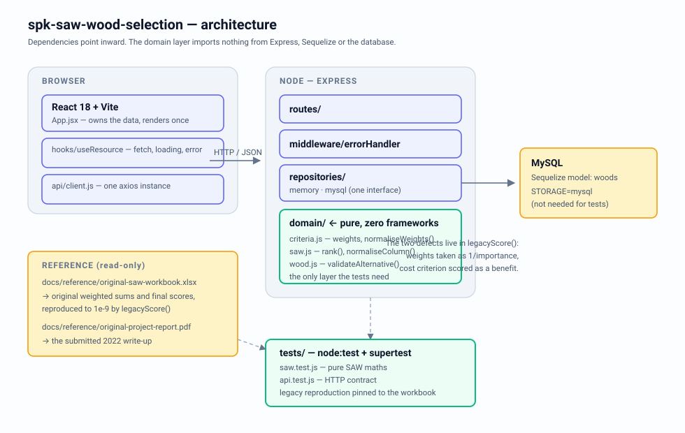

# SPK Pemilihan Kayu — Decision Support System with SAW

A full-stack decision-support application that ranks wood species for furniture
production. Given price and three inspected quality scores per species, it
applies **Simple Additive Weighting (SAW)** and returns a ranked recommendation.

This repository is a rebuild of my 2022 university final project. The rebuild
found that the original calculation was **wrong**, and this README shows the
working: the original pick drops to second place and the species it ranked last
comes first.

```
Backend    Node 20+ · Express 4 · Sequelize/MySQL (pluggable with an in-memory adapter)
Frontend   React 18 · Vite 6 · Bulma
Tests      40 assertions · node:test + supertest · no database required
Domain     Pure SAW implementation, framework-free, independently testable
```

## The finding

The original submission scored every criterion as `value / maximum`, including
**price**, and used `1 / importance` as each criterion's weight instead of
`importance / sum(importance)`. The four weights summed to **1.2833**, not 1.
A hard-coded `1` in the spreadsheet's total cell hid it.

Consequence: more expensive timber was rewarded, and the weight of "quality" —
the criterion the project's own title says it ranks by — was understated by
79% relative to price.

Running the same five species through both methods (`npm run verify:legacy`):

| Species | Price (IDR) | Original rank | Original score | Corrected rank | Corrected score |
|---|---:|---:|---:|---:|---:|
| Kayu Sungkai | 125,000 | **5** | 0.0877 | **1** | 0.8857 |
| Kayu Jati Belanda | 1,300,000 | **1** | 0.3049 | **2** | 0.6456 |
| Kayu Jati | 1,000,000 | 2 | 0.2568 | 3 | 0.5768 |
| Kayu Trembesi | 600,000 | 4 | 0.1556 | 4 | 0.4982 |
| Kayu Mahoni | 800,000 | 3 | 0.1951 | 5 | 0.4228 |

The original recommended **Kayu Jati Belanda** at 1,300,000 IDR. The corrected
method recommends **Kayu Sungkai** at 125,000 IDR — one tenth the price, with the
highest quality and condition scores in the set. The recommendation was not
merely mis-ranked; it was inverted.

`legacyScore()` is kept in the codebase and pinned by regression tests, so the
original numbers are reproducible to 1e-9 and the fix is verifiable rather than
asserted. See [`docs/evaluation.md`](docs/evaluation.md) for the full review.

## Architecture



Dependencies point inward. `src/domain/` imports nothing from Express, Sequelize
or the database, which is why the SAW maths is tested in milliseconds without a
running server. The repository interface has two adapters — in-memory and MySQL —
selected by one environment variable.

| Layer | Path | Responsibility |
|---|---|---|
| Domain | `backend/src/domain/` | Criteria model, SAW arithmetic, validation — pure functions |
| Repositories | `backend/src/repositories/` | Persistence behind one interface (`memory`, `mysql`) |
| Routes | `backend/src/routes/` | Thin HTTP surface, no business logic |
| Middleware | `backend/src/middleware/` | Error handling, async wrapping |
| App | `backend/src/app.js` | Builds Express from an injected repository (testable) |
| UI | `frontend/src/` | Presentational components; the parent owns the data |

## API

| Method | Path | Purpose |
|---|---|---|
| `GET` | `/health` | Liveness, active storage adapter |
| `GET` | `/api/woods` | List alternatives |
| `GET` | `/api/woods/:id` | Fetch one |
| `POST` | `/api/woods` | Create — validated, `422` on failure |
| `PATCH` | `/api/woods/:id` | Partial update |
| `DELETE` | `/api/woods/:id` | Remove |
| `GET` | `/api/ranking/criteria` | Criteria with normalised weights |
| `GET` | `/api/ranking` | Ranked result, per-criterion contributions, audit divisors |
| `POST` | `/api/ranking/preview` | Re-rank with caller-supplied weights (what-if) |

Verified live against a running server:

```
GET /health                     200  {"status":"ok","storage":"memory"}
POST /api/woods  (×5)           201
GET /api/ranking                200  divisors {price:125000, condition:2, quality:4, durability:5}
                                     #1 Kayu Sungkai 0.8857   #2 Kayu Jati Belanda 0.6456
POST /api/woods (price="abc")   422  {"details":["price must be a number"]}
POST /api/ranking/preview (bad weights)
                                422  {"details":["weights must sum to 1.0 (received 0.250000)"]}
GET  /api/nope                  404  {"error":"not_found"}
GET  /api/woods/9999            404  {"error":"request_error","message":"wood '9999' not found"}
```

`GET /api/ranking` returns the normalisation divisors alongside the scores. The
original UI never showed them, which is part of why the arithmetic error went
unnoticed for three years: a reviewer had no way to check the maths by hand.

## Quick start

```bash
cd backend
npm install
STORAGE=memory npm start     # no database required
npm test                     # 40 assertions

cd ../frontend
npm install
npm run dev                  # http://localhost:3000, proxies /api to :5000
```

For MySQL, copy `backend/.env.example` to `.env` and set `STORAGE=mysql`.

## What changed from the original

| Original | Problem | Now |
|---|---|---|
| `new Sequelize('crood_db','root','',{host:'localhost'})` in source | Credentials in version control, database name from a different project | `config/env.js` reads the environment; `.env.example` documents every key |
| `cors()` with no options | Every origin allowed | Explicit allow-list from `CORS_ORIGINS` |
| `catch (error) { console.log(error.message) }` with no `res.*` | Requests hung until the client timed out; operators saw only a log line | Errors always respond; central handler maps status codes |
| SAW computed in the browser, twice, in `TableFinal` and `TableHasil` | Two implementations that could disagree; three fetches per page load | One implementation in `domain/saw.js`, computed server-side |
| Table named `users` holding wood species; model `User` | Unreadable domain model | `Wood` / `woods` |
| `POST` wrote `req.body` straight to Sequelize | `{"price":"abc"}` reached the driver | `validateAlternative()` with field-level messages |
| `db.sync()` as an import side effect | Schema changes on every import, untestable | Explicit bootstrap in `index.js` |
| `nodemon` in `dependencies` | Ships a dev tool to production | `devDependencies`, `npm run dev` |
| Hard-coded `http://localhost:5000` in five React files | Undeployable anywhere else | Vite dev proxy + `VITE_API_URL` |
| `app.listen()` with no `error` handler | A busy port produced an unhandled exception | `EADDRINUSE` reported with guidance, clean exit |
| Zero tests | Every change was a guess | 40 assertions, in-memory adapter, no database needed |

## Layout

```
backend/
  src/domain/           criteria.js · saw.js · wood.js       (pure)
  src/repositories/     memoryRepository.js · sequelizeRepository.js
  src/routes/           woods.js · ranking.js
  src/middleware/       errorHandler.js
  src/app.js            createApp(repository)
  src/index.js          bootstrap, signal handling
  tests/                saw.test.js · api.test.js
  scripts/              reproduce-original-spreadsheet.js
frontend/
  src/api/client.js     one axios instance
  src/hooks/            useResource.js
  src/components/       WoodTable · WoodForm · RankingTable · CriteriaTable · NormalisationTable
docs/
  evaluation.md         the full review of the original work
  reference/            the original spreadsheet and report, unmodified
  architecture.svg
```

## Limitations

- The criteria weights (`3, 2, 5, 4`) are the ones the original project used.
  Nothing here validates them against a real purchasing decision — they are
  inputs, not findings.
- The `condition`, `quality` and `durability` scores are single-inspector
  judgements on a 0–5 scale. A production system would need a documented rubric
  and inter-rater agreement.
- Only five alternatives. SAW is stable at this size; it is not evidence that
  the ranking generalises.
- No authentication. The write endpoints are open by design, because this is a
  demonstration, not a deployed service.

## Licence

MIT. See [`docs/evaluation.md`](docs/evaluation.md) for the engineering review and
`docs/reference/` for the untouched 2022 artefacts.
